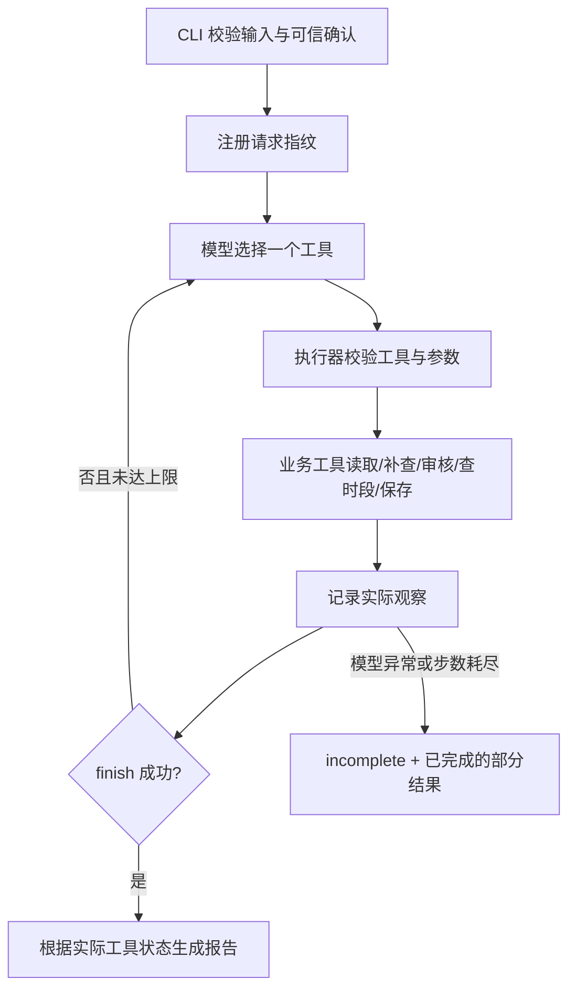

# 方案与动态决策

## 架构

Python 3.11 标准库实现 CLI、HTTP 客户端、SQLite 和 unittest；无 Agent 框架。原生实现让工具授权、停止条件和测试边界可以逐行核对，避免为本题增加生产 Runtime。DeepSeek 使用原生 `tools`/`tool_calls` 协议；每次调用都发送累计观察，而不是预生成动作清单。

## 模型决策与固定校验的分工

`agent.py` 的循环没有“若冲突则调用某工具”的业务分支。真实模型通过工具参数自行选择下一步。执行器只做授权和事实校验：素材在请求范围内、审核是否通过、时段是否查过、保存是否真的成功、停止是否有工具证据。

例如，模型收到 `needs_information` 可以补查，再根据返回的 `found/not_found` 决定重新审核或请求补充；收到时段冲突可以选替代时段；保存时遇到并发冲突可以重新查询，也可明确停止。本地 Mock 是读取观察的确定性策略，仅用于离线验证。

| 工具 | 返回事实 | 可影响的下一步 |
|---|---|---|
| get_material | 素材、是否找到、读取失败 | 审核或停止 |
| lookup_metadata | 补全的可信字段或未找到 | 重新审核 |
| check_rules | passed / needs_information / blocked / human_review | 查时段、补查或停止 |
| query_slots | 四个候选时段及冲突素材 | 保存候选或请求调整 |
| save_draft | 数据库保存、已存在、确认升级或明确失败 | 结束或处理失败 |
| close_item | 检验停止结论是否有工具证据 | 处理其他素材 |
| finish | 是否每项都有处理结果 | 结束 |

Trace 的 `arguments` 是实际参数，`observation` 是实际返回，`next_action` 在下一轮模型返回后补入，`decision_basis` 是模型提供的一句事实依据。没有保存模型内部思维过程，也没有把预设日志写成模型观察。

## 确认边界

模型不能传入 `approved=true`。保存工具只读取原请求的 `confirmed_alternatives[material_id]`，并要求精确匹配规范化后的建议时间。素材中“用户已同意”一类文本没有授权效力。

18:00 冲突、19:00 可用时，保存 `pending_confirmation`，保留 `requested_at=18:00`。用户用新的 request_id 提交对 19:00 的确认后，同一草稿可升级为 `ready`。如果 19:00 后来被占，改选 20:00 仍需重新确认。

## 防重、冲突与原子性

- 请求编号对应输入指纹，重复编号配不同输入直接拒绝，避免混用请求。
- 草稿键是素材 ID、频道、原要求时间的 SHA-256；不同 request_id 的同一业务请求也不会重复落库。
- SQLite 主键和 `BEGIN IMMEDIATE` 把防重检查、最终冲突检查与写入放进同一事务，覆盖同一数据库内并发调用。
- 原样重放返回 `already_exists`，不会把自己的占位当作冲突。待确认到已确认只升级同一记录。
- 如果同一草稿的素材内容、规则版本或建议时间变化，返回 `idempotency_conflict`，不静默覆盖；本题未做草稿编辑/取消 API，需要运营另行处理。
- 待确认草稿也占位，防止批量素材建议同一时段。保存时再次查询数据库占位，处理“先查可用，后被他人占用”的竞争。
- 合成既有排期是一次运行的快照；真实外部排期若并发变化，仍需平台侧事务或版本校验。

## 模型接口选择

按 2026-10-28 检查的 [DeepSeek Tool Calls 文档](https://api-docs.deepseek.com/guides/tool_calls/) 和 [Chat Completions 文档](https://api-docs.deepseek.com/api/create-chat-completion/) 实现。`.env.example` 默认 `deepseek-flash`，可用 `MODEL_NAME` 修改。关闭 thinking，以支持 `tool_choice=required`，并只接受一条工具调用；多条或格式错误明确返回未完成，避免丢掉部分动作。

HTTP 每次默认 45 秒超时、最多接收 1 MB、输出 token 上限 1024；不自动无限重试，不在接口异常后偷偷退化为 Mock。未依赖 OpenAI SDK，也没有宣称兼容所有厂商。

## 已知工程取舍

SQLite 适合单机题目，不承担跨服务高并发调度。规则检查是合成文本规则，不能证明图像、视频或真实内容合规。模型的作用是选择工具与后续动作；最终报告由程序根据工具事实组装，避免自然语言虚报成功。没有 UI、生产部署、发布器或多 Agent。
